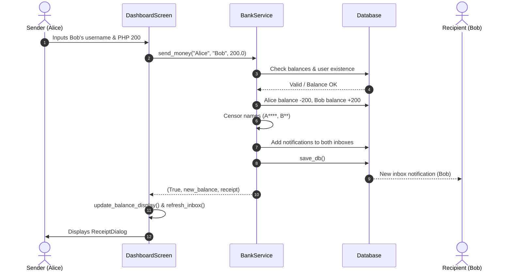
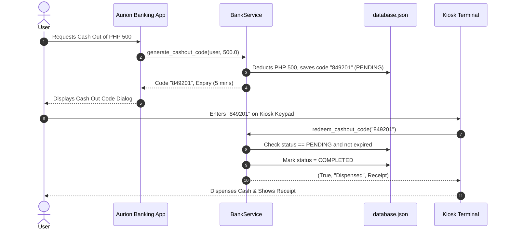

# Aurion

Aurion is a digital banking app inspired by GCash. You can cash in, send money to friends, pay bills, and withdraw cash from a simulated ATM kiosk using a one-time code. It's built with Python 3 and PyQt6, and everything is saved in a single JSON file, so there's no database server to set up.

The most important design choice: **the banking logic and the screens live in separate layers.** The logic doesn't know the UI exists, which makes it easy to test and easy to reuse if we ever move to web or mobile.

---

## Table of Contents

1. [How the project is organized](#1-how-the-project-is-organized)
2. [How data is stored](#2-how-data-is-stored)
3. [The core layer (the banking brain)](#3-the-core-layer-the-banking-brain)
4. [The UI layer (what you see and click)](#4-the-ui-layer-what-you-see-and-click)
5. [How things work, step by step](#5-how-things-work-step-by-step)
6. [Running and testing it](#6-running-and-testing-it)

---

## 1. How the project is organized

```
Digital Banking App (Gcash Clone)/
│
├── core/                     # Business logic only. No UI imports allowed.
│   ├── __init__.py           # Exports the services
│   ├── database.py           # Reads/writes the JSON file and finds users
│   ├── auth_service.py       # Sign-up and login
│   └── bank_service.py       # Money movement, cash-out codes, inbox, receipts
│
├── ui/                       # PyQt6 screens and styling
│   ├── __init__.py           # Exports the UI components
│   ├── theme.py              # Fusion style, QSS loading, icons
│   ├── login.py              # LoginScreen and SignUpDialog
│   ├── dashboard.py          # DashboardScreen (sidebar + pages)
│   └── kiosk.py              # AurionKioskTerminal (the ATM simulation)
│
├── icons/                    # PNGs for logos, buttons, and badges
├── database.json             # Where all the data lives
├── style.qss                 # Global Qt stylesheet
├── main.py                   # Starts the banking app
├── kiosk.py                  # Starts the kiosk terminal
├── test_core.py              # Headless tests for the banking logic
└── README.md                 # You are here
```

### Why we split it this way

- **The UI can change without touching the logic.** If we swap the desktop app for a website, `core/` stays exactly as it is.
- **The logic can be tested without opening a window.** Sending money, computing balances, and expiring codes are all checked in `test_core.py` with no Qt involved.

---

## 2. How data is stored

Everything is kept in one readable JSON file, with each user stored under their **username**:

```json
{
  "Coltan290": {
    "name": "Coltan Vance",
    "email": "coltan@example.com",
    "password": "mypassword123",
    "pin": "1234",
    "balance": 727.00,
    "inbox": [
      "[2026-10-20 18:15:17] Sent PHP 200.00 to J*** J******* D***.",
      "[2026-10-20 18:10:02] Cash In of PHP 500.00 successful."
    ],
    "cashouts": {
      "582914": {
        "amount": 200.0,
        "expires_at": "2026-10-20T18:21:00.123456",
        "status": "PENDING"
      }
    }
  }
}
```

### What the fields mean

- **`password` and `pin`**: Users can sign in with either one. The PIN is always 4 digits.
- **`inbox`**: A list of notification messages. These show up in the dashboard's inbox feed.
- **`cashouts`**: The temporary 6-digit codes used to withdraw cash at the kiosk. Each one is `PENDING`, `COMPLETED`, or `EXPIRED`.

> **Heads up:** Passwords and PINs are stored as plain text. That's fine for a school project, but a real banking app would hash them.

---

## 3. The core layer (the banking brain)

### `core/database.py`

The `Database` class is the only thing that touches `database.json`. It loads the file with `load_db` and saves it with `save_db`.

- `find_username_by_identifier(identifier)` takes whatever the user typed and finds their username. This is why people can log in with either their username or their email.
- `user_exists(username)` checks whether a username is already taken.

### `core/auth_service.py`

The `AuthService` class handles creating accounts and checking logins.

- `create_account(username, name, email, password, pin)` makes sure every field is filled in, the PIN is exactly 4 digits, and the username and email aren't already in use. New accounts start with a balance of `0.00`.
- `login(identifier, secret)` checks the credentials and returns `(success, username, error_message)`.

### `core/bank_service.py`

The `BankService` class does the actual banking: balances, transfers, notifications, and cash-out codes.

- `censor_name(name)` protects privacy by masking most of each name, so `"John Doe"` becomes `"J*** D**"`.
- `get_balance(username)` runs `check_expired_cashouts` first, so any expired code is refunded before you see your balance.
- `cash_in(username, amount)` adds money and records a receipt.
- `cash_out(username, amount)` handles a direct withdrawal.
- `generate_cashout_code(username, amount, validity_minutes=5)` takes the money out of your balance right away and holds it aside. It then creates a random 6-digit code with an expiry time.
- `check_expired_cashouts()` looks through all pending codes. If one is past its expiry, it marks the code `EXPIRED`, gives the money back, and notifies the user.
- `redeem_cashout_code(code)` is what the kiosk calls. It checks the code, marks it `COMPLETED`, and dispenses the cash.
- `send_money(sender, recipient, amount)` moves money between two users. Both inbox notifications use censored names.
- `pay_bill(username, biller_name, amount)` handles bill and merchant payments.

---

## 4. The UI layer (what you see and click)

### `ui/theme.py`

Sets Qt to the cross-platform "Fusion" style, loads `style.qss`, and sets the window and taskbar icon from `appicon.png` or `applogo.png`.

### `ui/login.py`

- **`LoginScreen`** is a split view: branding on the left, login form on the right. When login succeeds, it emits a `login_successful(username)` signal.
- **`SignUpDialog`** is a pop-up form for creating a new account.

### `ui/dashboard.py`

The dashboard is a single window. A sidebar on the left switches between pages using a `QStackedWidget`.

| Page | What it does |
|---|---|
| 0. Dashboard Home | A greeting, your balance card (with an eye icon to hide or show it), quick-action cards, and a live inbox feed |
| 1. Cash In | An inline form with a balance card on the right |
| 2. Cash Out | Generates a 6-digit code and shows it in `CashOutCodeDialog` |
| 3. Send Money | Recipient and amount form |
| 4. Payment | Biller or merchant and amount form |
| 5. Log Out | A confirmation card with a preview of your profile |

**Reusable widgets we built:**

- `ActionCard`: a clickable card with hover animations and an icon.
- `SideBalanceCard`: the balance panel that stays in sync across all transaction pages.
- `AmountInputBox`: a text field with a built-in "PHP" prefix.
- `ReceiptDialog`: a pop-up showing the transaction details (`TXN-ID`, `Ref-No`, timestamp).

### `ui/kiosk.py`

`AurionKioskTerminal` pretends to be a physical ATM. It has a touchscreen-style keypad (`0-9`, Clear, Backspace) and six digit boxes that fill as you type.

1. **Step 1:** Enter your 6-digit cash-out code.
2. **Step 2:** The kiosk confirms the cash was dispensed, shows a full receipt, and gives you a button to go back to the start.

---

## 5. How things work, step by step

### Sending money to someone



### Withdrawing cash at the kiosk

This is where the two apps work together: the banking app creates the code, and the kiosk redeems it.



---

## 6. Running and testing it

### Before you start

You need Python 3 and PyQt6:

```bash
pip install PyQt6
```

### Launch the banking app

```bash
python3 main.py
```

Two test accounts are already in `database.json`:

- Username `Coltan290`, password `password123`, PIN `1234`
- Username `student_1`, password `password123`, PIN `1111`

### Launch the kiosk

```bash
python3 kiosk.py
```

Generate a cash-out code in the banking app first, then type it into the kiosk.

### Run the tests

```bash
python3 test_core.py
```

This runs 5 automated tests covering account creation, duplicate prevention, cash-in, send money, and cash-out code generation. No windows open.
