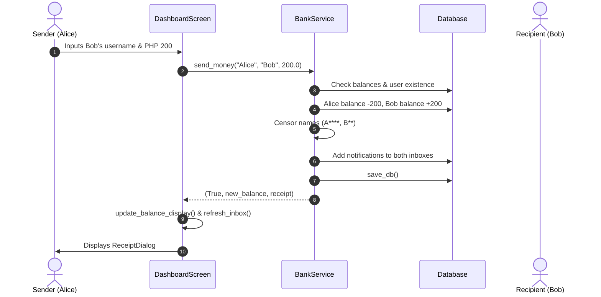
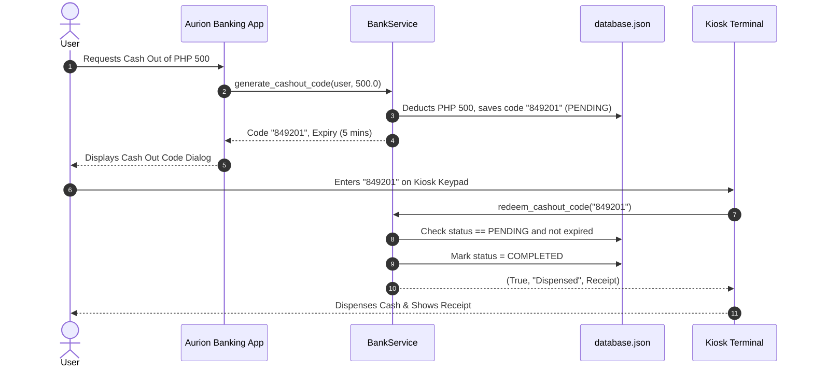

# Aurion — Project Architecture & Code Documentation

> **Project Name:** Aurion (Digital Banking App / GCash Clone)  
> **Framework:** Python 3 + PyQt6  
> **Storage:** JSON File Persistence (`database.json`)  
> **Design Pattern:** Layered Architecture (Separation of Core Logic vs. UI)

---

## 1. High-Level Architecture

The project is split strictly into two layers to ensure clean code, maintainability, and testability:

```
Digital Banking App (Gcash Clone)/
│
├── core/                     # Pure Python Business Logic (No UI imports)
│   ├── __init__.py           # Package exports for services
│   ├── database.py           # JSON file reading, writing, and user querying
│   ├── auth_service.py       # Authentication, registration, and credential validation
│   └── bank_service.py       # Transactions, balances, cashout codes, inbox, and receipts
│
├── ui/                       # PyQt6 Presentation Layer (Widgets & Styling)
│   ├── __init__.py           # UI component exports
│   ├── theme.py              # Fusion style, QSS loader, icon resolution
│   ├── login.py              # LoginScreen & SignUpDialog
│   ├── dashboard.py          # DashboardScreen (Sidebar, Pages, StackedWidget)
│   └── kiosk.py              # AurionKioskTerminal (ATM simulation)
│
├── icons/                    # App assets (PNGs for logos, buttons, badges)
├── database.json             # Flat-file database storage
├── style.qss                 # Global Qt stylesheet definitions
├── main.py                   # Main entry point (User Banking App)
├── kiosk.py                  # Secondary entry point (Physical Kiosk Terminal)
├── test_core.py              # Headless unit tests for core banking logic
└── README.md                 # Project architecture & developer documentation
```

### Why this design matters for a school defense:
* **Separation of Concerns:** If you want to change the UI or switch from desktop to web/mobile, `core/` remains 100% untouched.
* **Testability:** Core features (sending money, computing balances, expiring codes) are tested headless in `test_core.py` without needing Qt to open any windows.

---

## 2. Data Structure (`database.json`)

The entire application state is stored in a clean, human-readable JSON dictionary keyed by canonical **username**:

```json
{
  "Coltan290": {
    "name": "Coltan Vance",
    "email": "coltan@example.com",
    "password": "mypassword123",
    "pin": "1234",
    "balance": 727.00,
    "inbox": [
      "[2026-10-20 18:15:17] Sent PHP 200.00 to J*** J******* D***.",
      "[2026-10-20 18:10:02] Cash In of PHP 500.00 successful."
    ],
    "cashouts": {
      "582914": {
        "amount": 200.0,
        "expires_at": "2026-10-20T18:21:00.123456",
        "status": "PENDING"
      }
    }
  }
}
```

### Key Data Fields:
- **`password` & `pin`:** Dual credential support. Users can authenticate with either password or a 4-digit numeric PIN.
- **`inbox`:** Array of notification strings shown on the dashboard inbox feed.
- **`cashouts`:** Map of temporary 6-digit codes generated for ATM/Kiosk withdrawal. Status can be `"PENDING"`, `"COMPLETED"`, or `"EXPIRED"`.

---

## 3. Core Layer (Business Logic)

### `core/database.py`
* **Class:** `Database`
* **Purpose:** Single point of entry for reading (`load_db`) and writing (`save_db`) to `database.json`.
* **Key Methods:**
  - `find_username_by_identifier(identifier)`: Resolves an input to a canonical username, allowing users to log in with either their username or email address.
  - `user_exists(username)`: Checks if a username is already registered.

### `core/auth_service.py`
* **Class:** `AuthService`
* **Purpose:** Handles account creation and login credential validation.
* **Key Methods:**
  - `create_account(username, name, email, password, pin)`: Validates that all fields are provided, PIN is exactly 4 digits, and username/email are unique. Initializes balance to `0.00`.
  - `login(identifier, secret)`: Checks credentials. Returns `(success, username, error_message)`.

### `core/bank_service.py`
* **Class:** `BankService`
* **Purpose:** Manages balances, financial transactions, notifications, and code redemption.
* **Key Features:**
  - `censor_name(name)`: Privacy function. Masks middle letters (e.g., `"John Doe"` → `"J*** D**"`).
  - `get_balance(username)`: Automatically triggers `check_expired_cashouts` before returning balance to ensure expired funds are instantly refunded.
  - `cash_in(username, amount)`: Increases user balance and records receipt.
  - `cash_out(username, amount)`: Direct cash withdrawal.
  - `generate_cashout_code(username, amount, validity_minutes=5)`: Deducts funds immediately into escrow, creates a 6-digit random code, and sets an ISO expiration timestamp.
  - `check_expired_cashouts()`: Scans all pending codes. If `datetime.now() > expires_at`, marks code `"EXPIRED"`, refunds amount to balance, and notifies user.
  - `redeem_cashout_code(code)`: Used by the Kiosk. Validates code, marks `"COMPLETED"`, and dispenses cash.
  - `send_money(sender, recipient, amount)`: Peer-to-peer transfer. Censoring is applied to both parties' inbox notifications.
  - `pay_bill(username, biller_name, amount)`: Bill/merchant payment handler.

---

## 4. UI Layer (PyQt6 Presentation)

### `ui/theme.py`
* Configures Qt's base style engine to `"Fusion"` for cross-platform consistency.
* Loads `style.qss`.
* Sets the global window/taskbar icon via `appicon.png` or `applogo.png`.

### `ui/login.py`
* **`LoginScreen`:** Two-panel split view (Brand showcase on left, login form on right). Emits `login_successful(username)` signal upon authentication.
* **`SignUpDialog`:** Modal dialog with form inputs for registering new accounts.

### `ui/dashboard.py`
* **Navigation Architecture:** Single-window interface using `QStackedWidget` controlled by a modern left sidebar.
* **Stack Pages:**
  1. **Page 0 — Dashboard Home:** Greeting, hero balance card with eye toggle (show/hide balance), "Move your money" quick-action cards, and real-time inbox feed.
  2. **Page 1 — Cash In:** Inline form + right side balance card.
  3. **Page 2 — Cash Out:** Generates 6-digit code modal dialog (`CashOutCodeDialog`).
  4. **Page 3 — Send Money:** Recipient + amount inline form.
  5. **Page 4 — Payment:** Biller/merchant + amount inline form.
  6. **Page 5 — Log Out:** Confirmation card with current user profile preview.
* **Custom Reusable Widgets:**
  - `ActionCard`: Clickable card with hover animations and icons.
  - `SideBalanceCard`: Right-column balance widget updating across all transaction pages.
  - `AmountInputBox`: Input field styled with an integrated "PHP" currency prefix.
  - `ReceiptDialog`: Pop-up showing formatted transaction details (`TXN-ID`, `Ref-No`, timestamp).

### `ui/kiosk.py`
* **`AurionKioskTerminal`:** Simulates a physical ATM terminal.
* Features a touchscreen-style on-screen numeric keypad (`0-9`, Clear, Backspace) with 6 visual digit boxes.
* 2-Step Flow:
  1. **Step 1:** Enter 6-digit cash-out code.
  2. **Step 2:** Cash dispensed verification + full printed receipt display with a button to return to home.

---

## 5. Execution Flows

### Flow A: Peer-to-Peer Transfer (Send Money)


### Flow B: Cash-Out & Kiosk Redemption (Two-App Synergy)


---

## 6. How to Run & Test

### Prerequisites
Make sure Python 3 and PyQt6 are installed:
```bash
pip install PyQt6
```

### 1. Launching the Banking App
```bash
python3 main.py
```
*Test Accounts in `database.json`:*
- Username: `Coltan290` | Password: `password123` | PIN: `1234`
- Username: `student_1` | Password: `password123` | PIN: `1111`

### 2. Launching the Kiosk Terminal
```bash
python3 kiosk.py
```

### 3. Running Unit Tests
```bash
python3 test_core.py
```
Runs 5 automated unit tests verifying account creation, duplicate prevention, cash-in, send money, and cash-out code generation without opening any windows.

---

## 7. School Defense / Presentation Cheat Sheet

| Question | Recommended Answer |
|---|---|
| **What architecture did you use?** | "We used a 2-Tier Layered Architecture separating pure business logic (`core/`) from UI presentation (`ui/`). This ensures business rules can be unit tested without a GUI." |
| **How does data persist?** | "We use a flat-file JSON database (`database.json`) managed by `core/database.py`, loaded into memory on demand and serialized upon transaction completion." |
| **How do Cash-Out codes expire?** | "Each code records an ISO timestamp 5 minutes into the future. Every time a balance is queried or a code is redeemed, `check_expired_cashouts()` runs automatically, marking overdue codes as expired and refunding the escrowed money back to the user." |
| **How is privacy handled?** | "Sensitive names are masked using `censor_name()` so other users only see first initials and asterisks (e.g. `J*** D**`) in notifications and receipts." |
| **How does the app stay responsive?** | "All screen transitions in the dashboard use a `QStackedWidget` rather than destroying and recreating windows, resulting in instant navigation and shared state." |

